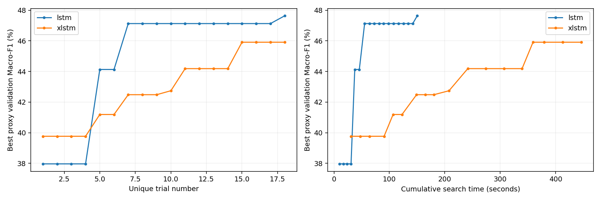
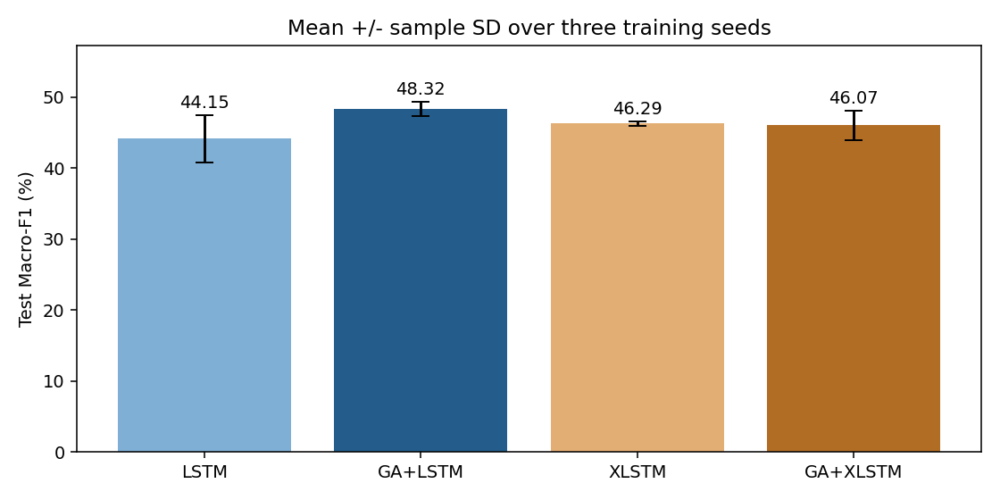
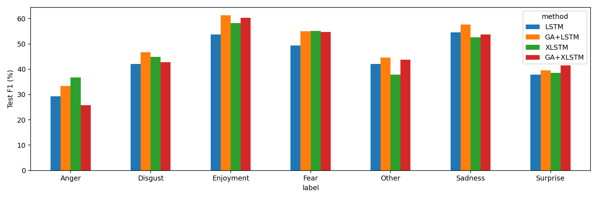
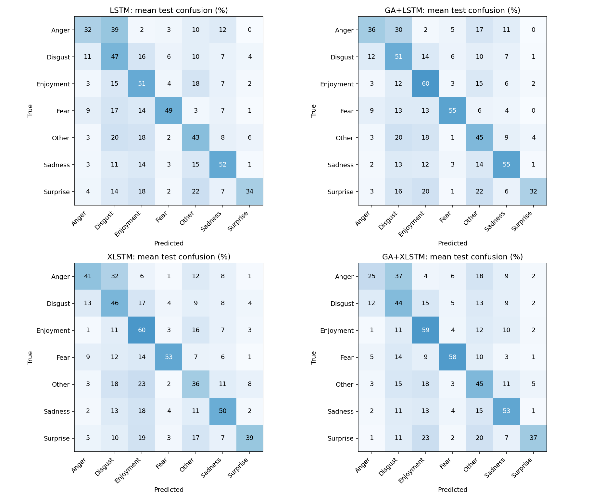

# GA + LSTM và GA + xLSTM trên UIT-VSMEC

Ngày chạy: 28/10/2026. Điểm là phần trăm, trung bình ± độ lệch chuẩn mẫu giữa các seed.

## Phương pháp

GA tìm siêu tham số; AdamW học trọng số mạng. LSTM và xLSTM giữ nguyên mã mô hình của thực nghiệm trước. xLSTM ở đây chỉ gồm các block mLSTM, không có sLSTM.

- Dữ liệu: 5547 train, 686 validation, 693 test; dùng lại chính xác tokenizer train-only đã lưu của baseline.
- Mỗi kiến trúc: quần thể 6, 3 thế hệ sinh thêm, giữ 2 elite. Tổng 18 cấu hình duy nhất, mỗi cấu hình 5 epoch; fitness = Macro-F1 validation tốt nhất.
- Tournament 3, uniform crossover xác suất 0.8, đột biến mỗi gene xác suất 0.1667. Loại đề xuất trùng, không tính lại fitness; trial lỗi vẫn chiếm ngân sách và xếp cuối.
- Seed tìm kiếm 71, seed train proxy 42. Hai kiến trúc dùng cùng quần thể ban đầu, có cấu hình baseline; các thế hệ sau khác nhau theo fitness.
- Chạy lại top 2 cấu hình trên seed [17, 29], tối đa 20 epoch, patience 5; chọn theo Macro-F1 validation trung bình. Nếu hòa chính xác, chọn trial ID nhỏ hơn.
- Khóa cấu hình rồi train từ đầu với seed [42, 123, 2026], tối đa 20 epoch, patience 5; chọn checkpoint bằng validation, không chọn seed tốt nhất.
- Chỉ đọc test sau khi đã lưu lựa chọn của cả hai kiến trúc và hoàn tất cả sáu lần train cuối. Cấu hình baseline được giữ nguyên từ thực nghiệm trước.
- Thiết bị: NVIDIA GeForce RTX 3050 Ti Laptop GPU; FP32. Batch 32, độ dài tối đa 128, masked mean pooling; không dùng embedding tiền huấn luyện.

## Không gian tìm kiếm và cấu hình được chọn

| Siêu tham số | Không gian chung | GA+LSTM | GA+xLSTM |
|---|---|---:|---:|
| embedding_dim | [64, 128] | 128 | 128 |
| num_layers | [1, 2] | 1 | 2 |
| dropout | [0.1, 0.3, 0.5] | 0.1 | 0.3 |
| learning_rate | [0.0003, 0.001, 0.003] | 0.003 | 0.003 |
| weight_decay | [0.0, 0.0001, 0.001] | 0.0 | 0.001 |
| class_weight_alpha | [0.0, 0.5, 1.0] | 0.0 | 0.5 |

Trial ID bắt đầu từ 0. Lựa chọn sau bước chạy lại:

- lstm: trial 17, Macro-F1 validation trung bình ở bước chọn cấu hình = 48.62%.
- xlstm: trial 17, Macro-F1 validation trung bình ở bước chọn cấu hình = 47.88%.

## Kết quả cuối

| Phương pháp | Val Macro-F1 | Test Accuracy | Test Macro-F1 | Test Weighted-F1 |
|---|---:|---:|---:|---:|
| LSTM | 43.23 ± 1.78 | 46.85 ± 2.78 | 44.15 ± 3.29 | 46.95 ± 3.00 |
| GA+LSTM | 49.22 ± 1.42 | 51.47 ± 0.73 | 48.32 ± 1.01 | 51.63 ± 0.63 |
| XLSTM | 44.48 ± 1.19 | 48.53 ± 0.68 | 46.29 ± 0.34 | 48.46 ± 0.50 |
| GA+XLSTM | 47.81 ± 0.31 | 49.49 ± 2.05 | 46.07 ± 2.06 | 49.41 ± 1.76 |

Sáu lần train cuối sau GA:

| Mô hình | Seed | Epoch chọn / đã chạy | Val Macro-F1 | Test Macro-F1 | Test Accuracy |
|---|---:|---:|---:|---:|---:|
| GA+LSTM | 42 | 5 / 10 | 47.64 | 49.28 | 51.37 |
| GA+XLSTM | 42 | 9 / 14 | 47.99 | 47.80 | 51.08 |
| GA+LSTM | 123 | 7 / 12 | 50.38 | 47.27 | 50.79 |
| GA+XLSTM | 123 | 18 / 20 | 47.99 | 46.62 | 50.22 |
| GA+LSTM | 2026 | 4 / 9 | 49.65 | 48.42 | 52.24 |
| GA+XLSTM | 2026 | 9 / 14 | 47.45 | 43.79 | 47.19 |

## Chênh lệch với cấu hình cố định

- GA+LSTM − LSTM: **+4.17 điểm phần trăm Macro-F1 test**, cao hơn ở 3/3 seed; độ lệch chuẩn của chênh lệch 2.31 điểm %.
- GA+XLSTM − XLSTM: **-0.22 điểm phần trăm Macro-F1 test**, cao hơn ở 2/3 seed; độ lệch chuẩn của chênh lệch 2.08 điểm %.

GA+xLSTM − GA+LSTM: **-2.25 điểm phần trăm Macro-F1 test**; GA+xLSTM cao hơn ở 0/3 seed.

Các chênh lệch trên là mô tả kết quả, không phải kiểm định ý nghĩa thống kê.

## Chi phí tìm kiếm và huấn luyện

| Kiến trúc | Trial thành công / tổng | Search (giây) | Chạy lại chọn cấu hình (giây) | Train cuối 3 seed (giây) | Tổng (giây) |
|---|---:|---:|---:|---:|---:|
| lstm | 18 / 18 | 150.3 | 82.4 | 43.3 | 276.0 |
| xlstm | 18 / 18 | 446.6 | 238.3 | 283.8 | 968.7 |

Thời gian search gồm train, validation, checkpoint và dọn bộ nhớ giữa trial. Các cột còn lại gồm train, validation, checkpoint. Tổng không gồm tiền xử lý, test và sinh báo cáo. Cùng số trial không đồng nghĩa cùng thời gian GPU. Thời gian baseline được ghi từ lần chạy trước, không phải phép benchmark đồng thời.

| Phương pháp | Tham số | Bộ nhớ tensor GPU đỉnh TB (MiB) | Train cuối TB / seed (giây) |
|---|---:|---:|---:|
| LSTM | 249223 | 109.6 | 27.2 |
| GA+LSTM | 497415 | 145.7 | 14.4 |
| XLSTM | 242903 | 243.9 | 102.6 |
| GA+XLSTM | 584087 | 318.7 | 94.6 |

## F1 test từng lớp

| Nhãn | LSTM | GA+LSTM | xLSTM | GA+xLSTM |
|---|---:|---:|---:|---:|
| Anger | 29.35 | 33.30 | 36.78 | 25.78 |
| Disgust | 42.13 | 46.76 | 44.87 | 42.75 |
| Enjoyment | 53.79 | 61.34 | 58.22 | 60.32 |
| Fear | 49.35 | 55.02 | 55.15 | 54.66 |
| Other | 42.08 | 44.56 | 37.93 | 43.81 |
| Sadness | 54.51 | 57.72 | 52.54 | 53.69 |
| Surprise | 37.86 | 39.55 | 38.56 | 41.48 |

## Giới hạn diễn giải

- Test này đã được xem ở thực nghiệm cấu hình cố định trước. Đây là nghiên cứu mở rộng mang tính thăm dò trên cùng test, không phải một lần xác nhận trên test hoàn toàn mới.
- Chỉ chạy một seed tìm kiếm GA cho mỗi kiến trúc. Ba seed cuối đo dao động huấn luyện của cấu hình đã chọn, không đo độ ổn định của chính quá trình tìm kiếm GA.
- Giữ seed cuối giống baseline để so sánh theo cặp; seed 42 cũng được dùng ở vòng proxy. Do đó không coi cả ba seed cuối là hoàn toàn độc lập với quá trình tìm cấu hình.
- Chưa có đối chứng random search cùng ngân sách, nên mức tăng so với cấu hình cố định không chứng minh GA tốt hơn các thuật toán tìm siêu tham số khác.
- Fitness 5 epoch là đánh giá ngắn, có thể ưu tiên cấu hình học nhanh. Chạy lại top 2 giảm phần nào rủi ro nhưng không bảo đảm tìm được cấu hình tối ưu.
- Dùng cùng không gian tìm kiếm/ngân sách epoch, nhưng số tham số, epoch dừng sớm và chi phí tính toán khác nhau. Không suy ra riêng tác động của từng thành phần kiến trúc.
- Tất cả lựa chọn cấu hình và checkpoint dùng validation; việc lặp nhiều trial có thể làm quá khớp validation. Không điều chỉnh GA từ điểm test.
- Cố định seed, bật deterministic ở chế độ warn_only; CUDA cumsum của mLSTM trong PyTorch 2.5.1 không bảo đảm tái lập từng bit.

## Biểu đồ và tái lập









Cấu hình: configs/ga_lstm_xlstm_comparison.json. Hướng dẫn: GA_EXPERIMENTS.md. Mỗi trial lưu checkpoint, lịch sử học, dự đoán validation và log; search_state.json lưu genealogy và quần thể mỗi thế hệ. locked_protocol.json và code/ lưu hash cùng bản mã nguồn chạy.

```powershell
python scripts/check_ga_search.py
python scripts/run_ga_comparison.py --outdir results/new_ga_run
python scripts/report_ga_comparison.py --outdir results/new_ga_run
python scripts/verify_ga_comparison.py --outdir results/new_ga_run
```

Nguồn kiến trúc xLSTM: [NX-AI/xlstm](https://github.com/NX-AI/xlstm); dữ liệu: [UIT-VSMEC](https://arxiv.org/abs/1911.09339).
