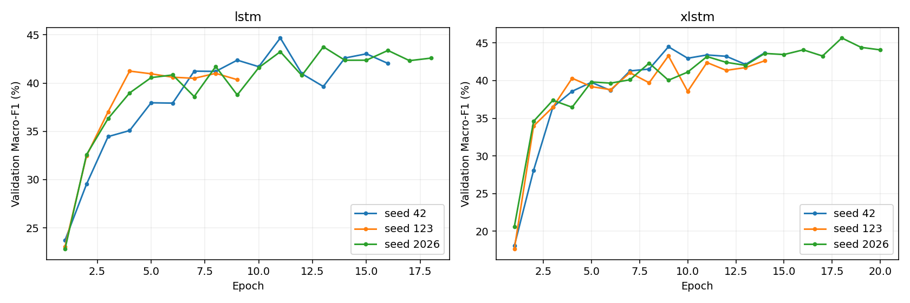
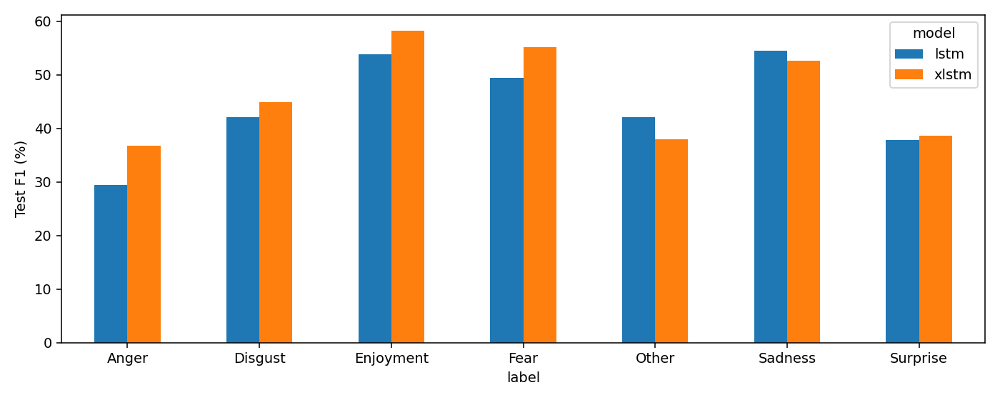
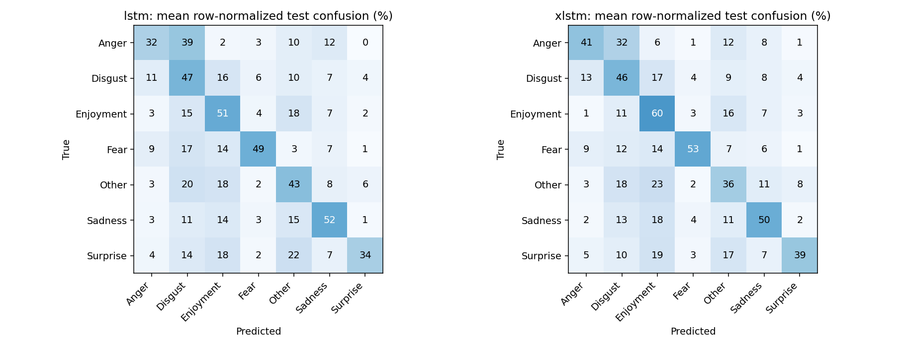

# Thực nghiệm LSTM và xLSTM trên UIT-VSMEC

Ngày thực nghiệm: 28/10/2026. Điểm trong bảng tính theo %, độ lệch chuẩn mẫu giữa các seed (ddof=1).

## Khác biệt kiến trúc

LSTM chuẩn giữ trạng thái ô nhớ dạng vector và điều tiết thông tin bằng các cổng. Biến thể mLSTM trong họ xLSTM dùng bộ nhớ ma trận, cổng hàm mũ được ổn định và được ghép thành các block residual. Backend của thí nghiệm tính mLSTM theo dạng song song bằng PyTorch; khả năng song song về thuật toán không bảo đảm nhanh hơn LSTM dùng cuDNN trên mô hình nhỏ. [Nguồn kiến trúc: Beck et al., 2024](https://arxiv.org/abs/2405.04517).

Thí nghiệm này đo khả năng phân loại bảy cảm xúc trên các bình luận ngắn, không phải bài kiểm tra chuyên biệt về ghi nhớ chuỗi dài.

## Thiết kế

- Train 5.547 mẫu (đã bỏ mẫu trùng validation), validation 686 mẫu, test chính thức 693 mẫu.
- Seed cố định: [42, 123, 2026]. Không chọn seed tốt nhất; không tìm siêu tham số.
- SentencePiece unigram: yêu cầu tối đa 4000 token, vocabulary thực tế 2845; học chỉ từ train; NFC, giữ dấu, chữ hoa, dấu câu và emoji; EOS, PAD bên phải; tối đa 128 token.
- Cả hai: embedding học từ đầu 64 chiều (khởi tạo giống nhau theo seed), 2 tầng, encoder một chiều, masked mean pooling, dropout 0.3.
- LSTM: torch.nn.LSTM + LayerNorm. xLSTM: xLSTMBlockStack chính thức với 2 block mLSTM, 4 head, convolution kernel 4, không có sLSTM.
- AdamW, LR 0.001, batch 32, weight decay 0.0001 (bỏ bias/norm), gradient clip 1.0, FP32; trọng số CE là (N/(7*n_c))^alpha với alpha=0.5, chuẩn hóa trung bình 1.
- Tối đa 20 epoch, patience 5; lưu checkpoint theo Macro-F1 validation cao nhất (hòa giữ epoch sớm hơn). Chỉ đọc test để đánh giá sau khi tất cả lần train hoàn tất.
- Thiết bị: NVIDIA GeForce RTX 3050 Ti Laptop GPU; PyTorch 2.5.1+cu121.

## Kết quả tổng hợp

| Mô hình | Validation Macro-F1 | Test Accuracy | Test Macro-F1 | Test Weighted-F1 |
|---|---:|---:|---:|---:|
| LSTM | 43.23 ± 1.78 | 46.85 ± 2.78 | 44.15 ± 3.29 | 46.95 ± 3.00 |
| xLSTM (mLSTM-only) | 44.48 ± 1.19 | 48.53 ± 0.68 | 46.29 ± 0.34 | 48.46 ± 0.50 |

Chênh lệch Macro-F1 test (xLSTM − LSTM): **+2.14 điểm phần trăm**, độ lệch chuẩn giữa các cặp seed 2.95.

Đây là so sánh cấu hình cố định với ba seed, không phải bằng chứng một họ kiến trúc luôn tốt hơn. Độ lệch chuẩn giữa seed không phải khoảng tin cậy trên quần thể dữ liệu.

## Từng lần chạy

| Mô hình | Seed | Epoch tốt nhất / đã chạy | Val F1 | Test F1 | Thời gian train (giây) |
|---|---:|---:|---:|---:|---:|
| lstm | 42 | 11 / 16 | 44.68 | 46.80 | 32.8 |
| xlstm | 42 | 9 / 14 | 44.49 | 46.57 | 113.5 |
| lstm | 123 | 4 / 9 | 41.25 | 40.47 | 20.9 |
| xlstm | 123 | 9 / 14 | 43.29 | 45.92 | 89.0 |
| lstm | 2026 | 13 / 18 | 43.76 | 45.18 | 27.8 |
| xlstm | 2026 | 18 / 20 | 45.66 | 46.39 | 105.3 |

## Chi phí và giới hạn so sánh

| Mô hình | Tổng tham số | Tham số ngoài embedding | Thời gian train TB (giây) | Peak GPU allocated TB (MiB) |
|---|---:|---:|---:|---:|
| lstm | 249,223 | 67,143 | 27.2 | 109.6 |
| xlstm | 242,903 | 60,823 | 102.6 | 243.9 |

Thời gian bao gồm huấn luyện, validation và ghi checkpoint; không gồm huấn luyện tokenizer. Peak GPU allocated là bộ nhớ tensor PyTorch, không phải toàn bộ VRAM của tiến trình. Đây không phải phép đo tốc độ inference.

Hai mô hình có cùng chiều embedding, số tầng và ngân sách epoch, nhưng không khớp tuyệt đối số tham số hoặc chi phí tính toán. Số epoch thực tế có thể khác do dừng sớm. Dropout và cấu trúc bên trong block khác nhau. Kết quả phản ánh toàn bộ hai cấu hình này, không tách riêng tác động của bộ nhớ ma trận.

Đây là xLSTM chỉ gồm mLSTM, không đại diện cho mọi tổ hợp mLSTM/sLSTM và không sử dụng mô hình xLSTM 7B hay embedding tiền huấn luyện. Chưa chạy GA hoặc so sánh sau tối ưu siêu tham số.

Đã cố định seed và bật deterministic ở chế độ warn_only: CUDA cumsum trong mLSTM không có kernel deterministic ở PyTorch 2.5.1, nên không cam kết tái lập chính xác từng bit. Mã nguồn có một sửa đổi lazy-import cho sLSTM CUDA để chạy khi thiếu CUDA Toolkit; không sửa phép tính mLSTM (xem vendor/README.md).

## F1 từng lớp

| Nhãn | LSTM | xLSTM | Chênh lệch (điểm %) |
|---|---:|---:|---:|---:|
| Anger | 29.35 | 36.78 | +7.43 |
| Disgust | 42.13 | 44.87 | +2.74 |
| Enjoyment | 53.79 | 58.22 | +4.44 |
| Fear | 49.35 | 55.15 | +5.80 |
| Other | 42.08 | 37.93 | -4.15 |
| Sadness | 54.51 | 52.54 | -1.97 |
| Surprise | 37.86 | 38.56 | +0.70 |

## Khác biệt quan sát được

- xLSTM đạt Macro-F1 test cao hơn LSTM ở 2/3 cặp seed.
- Lớp có chênh lệch xLSTM − LSTM cao nhất: Anger (+7.43 điểm %); thấp nhất: Other (-4.15 điểm %).
- Thời gian train trung bình của xLSTM bằng 3.78 lần LSTM trên thiết bị và backend này; đây không phải so sánh các kernel đã tối ưu ngang nhau.

File `paired_errors_test.csv` chứa toàn bộ văn bản, nhãn thật, dự đoán của từng seed và số seed dự đoán đúng, giúp phân tích lỗi mà không chỉ chọn ví dụ có lợi cho một mô hình.

Baseline TF-IDF + LinearSVC đã có đạt **53.19% Macro-F1 validation**. Chỉ đối chiếu cột validation; baseline này chưa được đánh giá test trong thực nghiệm hiện tại.

## Tiền xử lý

Vocabulary thực tế có thể nhỏ hơn 4.000 vì hard_vocab_limit=False. Thống kê dưới đây dùng tokenizer đã học trên train:

| Tập | Mẫu | Mẫu bị cắt ngắn | Token UNK / token trước cắt |
|---|---:|---:|---:|
| train | 5547 | 8 | 0 / 96208 |
| validation | 686 | 0 | 1 / 12207 |
| test | 693 | 0 | 3 / 12008 |

## Biểu đồ

## Tái lập và nguồn

Từ thư mục dự án: `python scripts/check_sequence_models.py`, sau đó `python scripts/compare_lstm_xlstm.py --outdir results/new_comparison` và `python scripts/report_lstm_xlstm.py --outdir results/new_comparison`.

Mỗi run lưu best.pt, history.csv, predictions/metrics validation và test; environment.json lưu phiên bản, SHA-256 dữ liệu, mã huấn luyện và tokenizer. locked_config.json ghi cấu hình trước khi train. Script từ chối ghi đè thư mục kết quả có dữ liệu.

Kiểm tra độc lập bằng bộ đánh giá có sẵn: `python scripts/verify_sequence_experiment.py --outdir results/new_comparison`. Kết quả kiểm tra lưu trong verification/verification.json.

- [xLSTM — bài báo NeurIPS 2024](https://arxiv.org/abs/2405.04517)
- [NX-AI/xlstm — commit đã pin](https://github.com/NX-AI/xlstm/tree/ab22eadbd245f293dd8dec38ed29963d73758a12)
- [UIT-VSMEC — Ho et al.](https://arxiv.org/abs/1911.09339)
